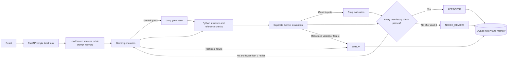

# LessonLoop

LessonLoop creates and evaluates beginner lessons for an Indian grade-12 graduate with limited English vocabulary and no assumed AI or coding knowledge. The prepared submission topic is **Introduction to RAG**.

Gemini is the primary generator and evaluator. On a Gemini quota/rate-limit response, the affected call automatically switches to configured Groq backup. Separate evaluation calls judge twelve rubric checks, and Python enforces two structure/reference checks. **Every mandatory check must pass** before release. Actual failures drive at most two rewrites; unresolved drafts end **NEEDS_REVIEW**.

The user originally chose Gemini only and later explicitly requested **Groq quota fallback**. No OpenAI service or SDK is used; Groq is called directly over HTTPS with a Qwen model by default. Separate calls and provider fallback do not guarantee accurate or independent judgments. [VERIFICATION.md](VERIFICATION.md) separates actual live results from mocked tests. [Sprint acceptance status](docs/SPRINT_STATUS.md) maps every sprint to its evidence and remaining human steps.

## Implemented system

React, TypeScript, Vite, and Tailwind provide a lesson studio, real event progress, reader, quality report, adjacent draft comparisons, feedback, history, memory, and downloads. FastAPI runs an actual LangGraph and persists structured records in SQLite. Source notes, claims, rubric, prompts, model identities, usage, and selected memory are versioned/auditable.



LangGraph makes nodes/state/conditional edges inspectable. Python decides release instead of averaging scores. SQLite is sufficient for this single-user assessment. One in-process task slot is shared by runs and improvements. Work does not survive a restart: unfinished records become INTERRUPTED, while saved drafts and completed history remain.

## Prerequisites and installation

Use working Python 3.11+, Node.js 20.19+ or 22.12+, npm, Git, and a Gemini API key with access to the configured models. Tested here with Python 3.11.16 and Node 24.14.0. Browser tests use installed Edge.

PowerShell from the project root:

```powershell
py -3.11 -m venv backend\.venv
.\backend\.venv\Scripts\python.exe -m pip install -r backend\requirements-dev.txt
cd frontend
npm ci
cd ..
if (-not (Test-Path backend\.env)) { Copy-Item backend\.env.example backend\.env }
if (-not (Test-Path frontend\.env)) { Copy-Item frontend\.env.example frontend\.env }
```

This machine's Python 3.12 cannot import `encodings`; the project already uses a working uv-managed 3.11. To recreate that environment:

```powershell
uv venv --python 3.11 backend\.venv
uv pip install --python backend\.venv\Scripts\python.exe -r backend\requirements-dev.txt
```

Activation is optional. Direct executable commands avoid PowerShell activation-policy problems. Optional activation: `.\backend\.venv\Scripts\Activate.ps1`. Use npm.cmd if npm's PowerShell wrapper is blocked. Exact dependency versions are locked in the requirements files and package-lock.json.

## Environment

Enter the key locally in backend/.env, never in chat or frontend settings:

```dotenv
APP_NAME=LessonLoop
APP_ENV=development
BACKEND_HOST=127.0.0.1
BACKEND_PORT=8000
FRONTEND_ORIGIN=http://localhost:5173
GEMINI_API_KEY=
GEMINI_MODEL=gemini-3.5-flash-lite
GEMINI_EVALUATOR_MODEL=gemini-3.5-flash
GROQ_FALLBACK_ENABLED=true
GROQ_API_KEY=
GROQ_MODEL=qwen/qwen3.8-27b
GROQ_EVALUATOR_MODEL=qwen/qwen3.8-27b
GROQ_MIN_INTERVAL_SECONDS=65
PROVIDER_TIMEOUT_SECONDS=30
WORKFLOW_TIMEOUT_SECONDS=90
TECHNICAL_RETRIES=2
```

The checked-in example uses Gemini 3.5 Flash-Lite for generation and Gemini 3.5 Flash for evaluation. Flash caught undefined technical terms missed by Flash-Lite in the recorded same-draft trial. The optional evaluator model defaults to GEMINI_MODEL when omitted. Gemini remains primary; only its HTTP 429 quota/rate-limit result authorizes automatic Groq use. Primary model labels and actual per-response providers are visible and recorded. No fallback occurs for invalid Gemini credentials, malformed verdicts or ordinary service outages. DATABASE_PATH optionally changes the SQLite file; relative values resolve under backend/. Default: backend/data/lessonloop.sqlite3.

Process environment variables override file values. The backend resolves .env from its source location; blank provider settings mean missing configuration. Restart after edits. Frontend .env contains only `VITE_API_BASE_URL=http://127.0.0.1:8000`. All VITE values are public; never put keys there.

## Start in two terminals

Backend, from the project root:

```powershell
cd backend
.\.venv\Scripts\python.exe -m app.main
```

Frontend, from the project root:

```powershell
cd frontend
npm run dev
```

Open [the app](http://localhost:5173), [Connections](http://localhost:5173/?view=connections), or [API docs](http://127.0.0.1:8000/docs). Health is at http://127.0.0.1:8000/api/health.

Use exactly localhost:5173 to match CORS. Vite uses a strict port. Update the backend URL and allowed origin together if ports change. Use **one backend process/worker**; this local task runner is not a distributed job system.

## Normal demonstration

1. Keep Introduction to RAG, the India grade-12 learner, and the reviewed RAG reference pack selected.
2. Leave factual-error injection unchecked; click Generate lesson once.
3. Expand live events. Stages come from the backend, not simulated animation.
4. Read the illustrative example, missing-information answer, recap, and expandable practice answers.
5. Inspect Quality report and Attempts. The count is informational; all mandatory checks must pass.
6. Download approved Markdown/audit JSON, or a clearly labelled review draft.
7. Reload `/?run=<id>` or use Run history to retrieve the saved record.

Other topics are rejected until a topic-specific source pack is added and reviewed. RAG references cannot approve an unrelated topic.

## Deliberate-error demonstration

Enable **Inject a factual error into the first draft**. The app first generates normally and preserves the original, then changes a claim to “RAG guarantees that the AI answer is always correct.” Only the altered lesson reaches the real evaluator, without a demo flag or desired verdict. Actual failed checks drive a rewrite; the error is never reinjected.

Attempts shows the original/altered claim, reasons, required changes, paragraph differences, and the next verdict. A missed error must be reported honestly as an evaluator defect, not hidden by hardcoded rejection. A saved real backup is in submission/backup-demo/.

## Memory and improvement demonstration

Failures count once per category per independent run, not per retry. Two completed supporting runs are required. Demonstration-origin observations are visible. Human feedback starts unverified; review can verify/dismiss it, but arbitrary feedback text never enters prompts automatically.

In Memory & learning, choose an eligible category and Compare prompts. A vetted instruction creates an inactive candidate version. Baseline and candidate each generate from the same normal assignment and targeted calibration scenario, then use the fixed rubric. Up to four generations and twelve focused evaluation calls run, each with at most two technical retries. Every lesson is checked in three groups of four mandatory checks; the merged result must contain all twelve model checks plus the two code checks.

Activation requires a targeted baseline failure to become a candidate pass with no per-check regression on baseline-passing checks. Ties end NO_IMPROVEMENT and stay inactive. Active memory is selected by topic/learner, capped at four instructions, and saved with each future run. Rollback restores the original or a previously activated version. A tiny stochastic comparison is limited evidence, not proof of universal improvement.

## Tests and live calibration

Backend, from backend/:

```powershell
.\.venv\Scripts\python.exe -m pytest -q
```

Frontend, from frontend/, with the backend running:

```powershell
npm run typecheck
npm run build
npm run test:ui
```

Automated inference is mocked and costs no API credits. Local health/configuration requests do not infer. Playwright uses installed Edge; PLAYWRIGHT_CHANNEL=chrome selects installed Chrome. pytest and browser profiles keep temporary data on the project drive.

For real paid evaluator testing, wait for app jobs to finish, then from backend/:

```powershell
.\.venv\Scripts\python.exe -m app.cli calibrate --split calibration --out ../submission/evaluator-calibration.json
.\.venv\Scripts\python.exe -m app.cli calibrate --split holdout --out ../submission/evaluator-holdout.json
```

`--split all` combines both. Five calibration and five holdout examples have reviewed per-check labels. Only labelled checks count toward disagreements. Reports separate false overall approvals/rejections, per-check false passes/rejections, and technical errors. Holdout is excluded from improvement. Once run, call it a fixed held-out test set, not unseen data; never retune on it and still call it unseen.

CLI utilities, from backend/:

```powershell
.\.venv\Scripts\python.exe -m app.cli run --wait
.\.venv\Scripts\python.exe -m app.cli run --demo-error --wait
.\.venv\Scripts\python.exe -m app.cli export <run-id> --out ../submission/final-lesson
```

The run command uses the running API. Exports preserve actual status and cannot approve a review draft.

## Output and reviewer files

- backend/content/: primary sources, paraphrased claims, frozen rubric, versioned prompts, fixture lesson, and dataset review.
- backend/app/dataset.py: inspectable labelled mutations and calibration/holdout splits.
- backend/data/lessonloop.sqlite3: ignored history/memory database; preserve it across restarts.
- submission/final-lesson/: actual approved lesson Markdown, rejection log, audit JSON, and metadata.
- submission/backup-demo/: clearly labelled saved live deliberate-error run.
- submission/evaluator-calibration.json and prompt-improvement.json: actual evidence when those operations ran.
- submission/lesson-for-google-docs.html: clean document for Google Docs or Notion import/copy.
- docs/DESIGN.md: implemented design, safeguards, one-day trade-offs, and production work.
- docs/VIDEO_WALKTHROUGH.md: 15–20-minute face-visible script and checklist.
- VERIFICATION.md: actual results. artifacts/ holds ignored QA screenshots/downloads.

## API

Sprint 1 health, provider configuration, and manual Gemini check endpoints remain. Health/status work without keys and never call a model.

| Endpoint | Purpose |
| --- | --- |
| GET /api/workspace | Sources, rubric, models, preset, limits |
| POST /api/runs | HTTP 202, supported input, bounded job |
| GET /api/runs?limit=10&offset=0 | Paginated history |
| GET /api/runs/{id} | Status, drafts, checks, memory, released lesson or review draft |
| GET /api/runs/{id}/events?after=0 | Ordered event cursor |
| POST /api/runs/{id}/feedback | Unverified observation |
| POST /api/feedback/{id}/review | Human review with note |
| GET /api/memory | Instructions, failure counts, versions, experiments |
| POST /api/improvements | Bounded prompt comparison |
| GET /api/improvements/{id} | Comparison progress and evidence |
| POST /api/prompts/rollback | Restore eligible validated prompt |
| GET /api/runs/{id}/export?format=markdown | Correctly labelled lesson or review draft |
| GET /api/runs/{id}/export?format=json | Full audit, including technical failures |

Application errors use status, error_code, and an actionable sanitized message. Input validation uses FastAPI 422. Busy is 409, missing settings 503, provider quota 429, and timeout 504. Malformed verdicts never authorize release.

## Troubleshooting and limits

- Backend unavailable: start it separately, check the URL, and retry explicitly.
- Credentials/model/quota: edit backend/.env, restart, and check account access/credits. Only the explicitly configured Groq quota fallback changes provider/model; the change is recorded. An earlier verification key returned a 20-request daily Flash limit; see submission/quota-blocker.json. One comparison needs twelve evaluator calls before retries, and each five-case calibration split needs fifteen. Schedule against your actual project quota; do not repeatedly retry a daily 429.
- Interrupted: the process stopped; inspect preserved history and start a new run.
- CORS: localhost:5173 and 127.0.0.1:5173 differ. Match FRONTEND_ORIGIN.
- Python encodings error: create .venv with a working interpreter; avoid deleting global installations.
- Full C drive/error 112: set TEMP, TMP, UV_CACHE_DIR, and npm_config_cache under the ignored project .cache directory before installation. No user files need deletion.
- Gemini HTTP 503: the service is temporarily busy. LessonLoop retries transient server/network failures at most twice with increasing waits and jitter (normally 4–5 then 8–9 seconds), keeping the same model and request format. Longer provider wait instructions stop the automatic retries. If retries are exhausted, use **Try again** to start a new run; the failed run remains in history. Authentication and daily quota errors are not automatically retried.
- Gemini schema/evidence errors: bounded technical retries can repair requests/responses; unresolved failures remain ERROR. Early unsuccessful development runs are preserved honestly.

This is **local development software**. It binds to loopback by default. Writes require development mode and the configured browser origin; CORS is not authentication. Public deployment still needs access control, spending limits, and durable execution.

Every generation, evaluation, connection, comparison, and calibration call consumes provider quota and can incur charges under the account plan. No inference runs on page load. Content retries are at most two; technical retries are separate and at most two per generation or focused evaluation request. Evaluation uses three focused requests per draft, each with at most two retries; a partial result cannot approve.

A human must record/upload the face-visible video and import/publish the document if a sharing link is required. No recording URL, document sharing URL, or assessment submission is invented.

Primary reference links/access dates are in the source pack. No third-party application code was copied; dependencies retain their licenses. SDK syntax follows the [Google SDK](https://github.com/googleapis/python-genai), [structured-output docs](https://ai.google.dev/gemini-api/docs/structured-output), and [LangGraph Graph API](https://docs.langchain.com/oss/python/langgraph/graph-api).

Repository: [sriram-Kannan-45/LessonLoop](https://github.com/sriram-Kannan-45/LessonLoop).

## Automatic Groq quota fallback

1. Put the Groq key only in `backend/.env` as `GROQ_API_KEY=...`; never put it in frontend variables or Git. Keep the model fields from `.env.example`, or choose Groq models your account supports.
2. Restart the backend. The studio displays **Groq quota fallback** and whether the key is configured. Configuration is not a successful live connection check. Connections tests the Gemini primary only; a primary quota failure does not test Groq access.
3. Generate normally. Gemini is always tried first unless that same model has a cached quota cooldown. On HTTP 429, the affected generation or evaluator request switches to Groq automatically. A judge quota does not disable a healthy Gemini generator.
4. Inspect live events and the provider trace for each draft. They identify the actual provider/model, including mixed Gemini/Groq evaluation groups. Audit JSON stores the same information. Run model fields remain the originally configured primary snapshots.

The same JSON/schema, source, evidence, strict-boolean and all-mandatory-check validation applies to Groq. A fallback is not approval. If Groq also fails, the run remains ERROR and saved drafts are retained. Authentication failures and non-quota Gemini failures do not switch providers. There is no provider loop.

Quota cooldowns are per Gemini model in the current backend process. The provider retry time is used when available; absent that hint, a daily quota is cached for one hour and another rate limit for one minute. Once the cooldown expires, the next request tries Gemini again. Restarting clears these in-memory cooldowns; it may make one new Gemini quota request before switching again.

The default Groq request interval is 65 seconds to reduce token-per-minute failures on its free plan. Waiting is shown as a real workflow event. Requests omit duplicate prompt schemas and use bounded completion budgets; outside usage, large prompts or daily token limits can still cause Groq 429. Change `GROQ_MIN_INTERVAL_SECONDS` only for the actual allowance of your account. Groq's strict schema rules are applied in the transport; all original Pydantic rules remain enforced locally.

A prompt comparison cannot activate if the actual generation/evaluation provider signatures differ across its arms: the result is INCOMPARABLE, not credited to the prompt. Historical Gemini-only runs remain unchanged.

Official Groq references: [Chat API](https://console.groq.com/docs/api-reference), [structured outputs](https://console.groq.com/docs/structured-outputs), [free-plan limits](https://console.groq.com/docs/rate-limits). Live Groq quality and account access still need verification with a real configured key; deterministic transport tests do not establish model accuracy.
