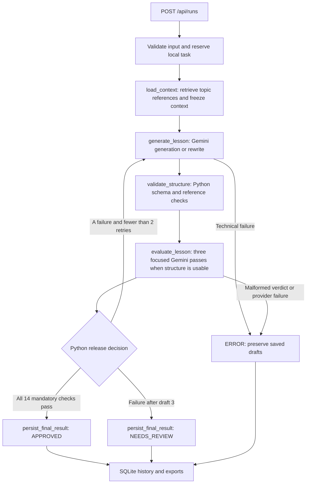

# LessonLoop design and assessment decisions

## Scope and learner

LessonLoop accepts an entered topic with usable public references, creates a standalone beginner lesson, checks it against its frozen rubric, and uses actual failures to request corrections. The target learner is an Indian grade-12 graduate from a non-English-medium school, with limited English vocabulary and no assumed specialist background. Engineering details stay in reports rather than learner explanations.

The user originally chose Gemini only and later explicitly requested Groq fallback when Gemini quota is exhausted. Role calls remain separate and stateless; Gemini is primary and the quota-limited role can switch to Groq. The current example configuration generates with Gemini 3.5 Flash-Lite and evaluates with Gemini 3.5 Flash. A recorded same-draft trial showed Flash catching undefined terms that Flash-Lite missed; this is evidence for the explicit configuration change, not a guarantee of independent judgments. The evaluator receives no generator self-assessment, desired verdict, or demo flag. This is call separation, not independent-provider evaluation. Shared model mistakes remain possible. The OpenAI requirement in the original assessment is intentionally superseded by that user decision.

## Implementation milestones

1. Retain and test the working Sprint 1 configuration, health, and Gemini smoke check.
2. Review primary RAG references; freeze the lesson schema, sources, and rubric.
3. Implement LangGraph nodes and code-enforced release/retry invariants.
4. Persist every draft, verdict, event, feedback record, and version in SQLite.
5. Add bounded cross-run memory and baseline/candidate prompt comparisons.
6. Expose the workflow through FastAPI and a React workspace.
7. Exercise deterministic tests, desktop/mobile browser paths, real generation, deliberate errors, and evaluator datasets.
8. Save approved outputs, audit history, reviewer documentation, and recording materials.

## Components and data flow

- `app/topics.py`: fixed-endpoint topic search, revision-pinned excerpts and the generic beginner rubric.
- `app/content.py`: loads version-controlled source notes, claims, rubric, and prompt versions; computes local content hashes.
- `app/lesson_schemas.py`: strict Pydantic lesson, example, evaluator, input, and feedback schemas.
- `app/services/lesson_ai.py`: official Google Gen AI async client, role-specific structured schemas, timeout, bounded technical retry, usage metadata, and secret redaction.
- `app/quality.py`: structural checks, reference/claim validation, complete unique check-ID validation, evidence provenance checks, and all-check release rule.
- `app/workflow.py`: actual compiled LangGraph with frozen context, generation, validation, evaluation, conditional rewrite, and final persistence.
- `app/db.py`: transactional SQLite repository with foreign keys, uniqueness constraints, indexes, immutable draft copies, and version history.
- `app/improvements.py`: controlled instructions derived from repeated categories and paired calibration comparisons.
- `app/runtime.py`: one in-process task slot shared by runs and improvements.
- `app/api/workspace.py`: requests, history, cursor events, feedback review, memory, improvement, rollback, and exports.
- React: create panel, backend-driven progress, reader, check report, attempt differences, feedback, history, memory, and connection setup.

## Grounding and reference provenance

New runs accept arbitrary subject names and collect topic references on demand. The fixed English Wikipedia API supplies search results and bounded text excerpts, with revision IDs/URLs, access times and CC BY-SA attribution. Source/claim mappings are derived from the retrieved excerpts and frozen before generation. These are automatically retrieved secondary sources, not human-reviewed reference packs. Missing or unavailable references stop the run without inventing citations. The original primary-source RAG pack remains for historical and explicitly selected legacy RAG workflows. Local hashes describe the frozen excerpts, not entire remote webpages.

Both roles receive the same frozen reference excerpts. The generator cites known source IDs and claims. Python checks that those identifiers and links exist. The evaluator separately judges whether actual factual claims are supported; identifier validity alone cannot establish that. Subject examples are clearly labelled illustrative teaching data. Legacy scholarship examples remain invented, never real eligibility or deadline advice.

## Rubric and evidence rules

There are two code checks and twelve model checks. General checks cover learner assumptions, explained terminology, example quality, coherent progression, recap, and correct practice answers. New topic checks cover accurate definition, relevance, explanation, key concepts, distinctions, supported facts, scope/assumptions and absent-information behavior. The old RAG-specific checks remain frozen only for legacy RAG runs.

Every check has a stable ID, pass/fail conditions, required evidence, evaluator type, and mandatory flag. All IDs must appear exactly once in their expected set. String values such as `"true"` are not accepted as booleans. Unknown claims, duplicated IDs, missing IDs, and fabricated evidence cannot authorize approval.

Evidence text is checked against the lesson after whitespace normalization. If the model uses explicit omission marks, each quoted fragment must exist in the lesson. This checks provenance, not the semantic soundness of the judgment. Missing content requires an explicit missing-content explanation, not an invented quote. A model can still cite real text and interpret it incorrectly; the labelled evaluator dataset measures examples of that weakness.

For the terminology group, Python supplies the first field containing selected specialist terms as an attention aid. Occurrence alone never determines a verdict: Gemini still judges whether the term needs and receives an ordinary-language explanation. This addresses an observed false pass on undefined weights and pipeline; it does not guarantee semantic correctness. Sentence lengths and word counts are reported only as diagnostics. They neither prove suitability nor replace rubric decisions. The roughly 700–1,100-word target is a generation guideline.

## Attempts and technical failures

The initial draft plus at most two content rewrites gives a maximum of three attempts. Each attempt receives its own row and immutable draft. Actual failed check results, excerpts, and requested corrections go into the next generation request. Successful checks are not averaged against failures. A run with unresolved failures ends `NEEDS_REVIEW`, never automatically approves the last draft.

Technical retries are separate and configured to at most two retries per generation or focused evaluation request. Google SDK automatic retries are disabled. Generation retries timeouts, server errors and interrupted connections with bounded increasing backoff and jitter; a native-schema argument rejection can instead make one changed-format JSON-mode request. Evaluation uses three fixed groups of four checks. Each group has at most three requests, including format/evidence repair or technical retry: at most nine evaluator requests per draft. Python validates each expected subset and then the complete merged twelve-check result; an incomplete group cannot release a lesson. Authentication and quota errors are not deliberately retried. Retry events record the role and category. Only the explicitly configured quota fallback changes provider/model, and actual identities are recorded per response. A repaired format still needs a fresh valid, complete evaluation; a retry itself cannot approve anything.

Gemini structured schema handling required a live-tested correction: the lesson uses its complete reference-based Pydantic JSON schema, while the evaluator uses an inlined shape schema with provider-side length/array bounds removed to avoid schema-state rejections. All original limits and types remain enforced by Pydantic locally. A rejected schema request or evaluator format repair may use a JSON-mode repair with the complete schema in its input; the model/provider stay unchanged, and local validation is identical. Both roles normally use `response_json_schema`. Evaluation requests ask for medium internal thinking, without exposing hidden reasoning. The invalid early runs remain in the local audit history rather than being relabelled successful.

## Persistence and process restarts

SQLite stores reference-pack snapshots, prompt versions, runs, attempts, individual check results, ordered workflow events, failure observations, feedback, memory instructions, and improvement experiments. Foreign keys and unique constraints prevent orphaned check results, duplicate attempt numbers, duplicate check IDs, and multiple active records of the same work type. Database operations use transactions; the database uses WAL mode and a bounded busy timeout.

The app supports one server process and one active task. Async tasks are held by the runtime, not fire-and-forget response callbacks. On startup, active records left by a previous process become `INTERRUPTED`; completed history is preserved. Shutdown cancels the owned task and records interruption. No claim is made that tasks survive a restart or that a LangGraph checkpoint resumes external calls. Starting a new run is the recovery path.

## History versus reusable memory

History is the full record of what happened. Reusable memory is a small selected set of validated teaching instructions. Failure observations are unique per run and category, so three retries in one run are one independent observation. Selection uses the matching topic, supported learner preset, and category; at most four active instructions are loaded, and each run saves their IDs and text snapshots.

At least two independent completed runs must support a category before a comparison can start. Demonstration-origin observations are explicitly identified in memory provenance. A reviewed human observation can contribute evidence, but its arbitrary text is never inserted into a prompt. Proposals use inspectable, vetted category-specific instruction templates.

## Controlled prompt improvement

An experiment creates an inactive candidate prompt version with a proposed addition. The current and candidate prompts each generate a fresh lesson from the same two scenarios: the normal UI assignment without a correct lesson seed, and a labelled seed covering the selected failure. The earlier protocol supplied a correct seed in the first case; audited v2 removes it because the seed masked jargon failures observed in normal runs. Both resulting lessons are judged with the same frozen rubric and sources. Each generated comparison draft and its generation usage are persisted before evaluation begins, so an evaluator timeout preserves the unevaluated draft without treating it as a passed arm. Technical retry records are saved as they occur. The holdout set is never used for this process.

Per-case baseline and candidate drafts, verdicts, usage, technical retries, seed hashes, model identities, and rubric/reference versions are retained. Activation requires at least one targeted baseline failure to become a candidate pass and no per-check regression from a baseline pass. A tie or a failed comparison leaves the candidate inactive. The rubric is not weakened to make a candidate succeed. The active prompt and its memory can be rolled back to the original or a previously activated version.

This small, stochastic, non-blinded generation comparison is limited evidence. It is not a statistical guarantee of improved teaching. A live `NO_IMPROVEMENT` result is useful evidence and must not be renamed success. Deterministic tests use clearly mocked model responses to exercise activation, cross-run selection, persistence, and rollback even when a live candidate has no observed benefit.

## Feedback, exports, and safe rendering

Feedback categories are factual issues, confusing language, missing examples, and corrections. New observations are unverified. A local human review can verify or dismiss a record, with a review note. Promotion still requires the controlled comparison gate.

React renders generated content as text; it never executes raw lesson HTML. Reference links come from the frozen retrieved pack or the legacy reviewed pack, never arbitrary model URLs. Only approved runs receive an approved-lesson export label. Other drafts carry a review/not-approved label. JSON audit exports include run state, version snapshots, every attempt, verdicts, and events. Technical runs without a draft still have audit exports.

## One-day trade-offs and production work

- One local process and in-process task slot, rather than a queue service or distributed workers.
- Polling with a cursor, rather than WebSockets.
- SQLite rather than a separate database service.
- One approved topic pack and one learner preset; no unreviewed live research.
- No auth or public deployment. Changes require development mode and the configured browser origin; the server binds to loopback by default. CORS is not authentication.
- Calibration is an explicit paid CLI operation; do not run it concurrently with active app jobs.
- Full production work still includes authenticated access, secret management, durable job recovery, database migrations, broader human-labelled data, spending budgets, privacy controls, and model/version monitoring.

Actual test counts, run IDs, evaluator disagreements, and improvement outcomes are recorded separately in VERIFICATION.md and the submission folder. This document describes implemented mechanisms, not an assertion that every model judgment is correct.

## Model trial and evaluation limits

A separate, explicitly disclosed trial of gemini-3.8-flash as evaluator did not return a usable result, including a provider HTTP 504 deadline on a minimal request. The application was not silently changed to that unverified model. That trial did not change the model at the time. During the later sprint audit, an explicitly recorded Gemini 3.5 Flash trial returned valid judgments and caught naturally occurring jargon failures; the current evaluator setting was then changed to Flash while generation remained Flash-Lite. Evaluator-v2 and evaluator-v3 live reports preserve their actual false passes and technical failures. The v3 revision was based on calibration contradictions; its repeated held-out diagnostics are explicitly labelled as reused data, not unseen validation.

## Final evidence extraction and teaching-notice guard

Evaluator-v4 can select an existing lesson field by a validated evidence_path with empty evidence text. Python resolves the exact text from that field, capped at 2000 characters. Unknown paths and fabricated nonempty quotes still fail closed. The evaluator still supplies its own verdict and reason; selecting a field is not evidence that its interpretation is correct. Direct exact quotations remain supported. This reliability change does not weaken the rubric or hardcode a verdict for the deliberate error.

Source pack rag-primary-v1.1 adds a reviewed, explicitly invented Asha College teaching notice. Rubric beginner-rag-v1.1 strengthens the code reference check to require an explicit illustrative, fictional, or invented label on the worked example. It does not detect or hardcode the deliberate false-correctness claim. Earlier runs keep their original source and rubric snapshots, and the reader/export uses those frozen references.

## Sprint audit correction: bounded prompt content

The original candidate builder bounded selected memory IDs but appended every prior instruction to the prompt text. It now rebuilds a candidate from the frozen base prompt plus at most the latest three retained instructions and the new proposal. A five-version regression test checks that both selected IDs and actual prompt text contain at most four learned instructions; full version history remains available for rollback.

## Temporary provider outage recovery

A real failed run returned Gemini HTTP 503 before saving a draft. Error mapping now distinguishes service unavailability, server errors, interrupted connections and unknown failures. Transient failures retry up to twice with bounded increasing backoff and jitter, respecting provider retry delays up to 30 seconds. Longer waits, authentication errors and daily quota errors return without automatic retry. SDK retries remain disabled. Availability retries preserve the model, structured schema and instructions; only a format/evidence failure changes the request into JSON repair mode. The React error panel explains old saved 503 failures using their diagnostics and offers an explicit Try again action that creates a new run and preserves the failed record.

Citation correction is explicit: a failed source check identifies each invalid source/claim pair and the allowed pairs. Generation receives that same mapping derived from the approved source snapshot. The check still rejects unapproved pairs; this improves corrective feedback without weakening the rubric or silently rewriting citations.

## Quota-only Groq routing

LessonAI wraps the primary Gemini request. Only RATE_LIMIT_OR_QUOTA triggers the configured Groq model for that role. A per-model in-memory cooldown uses the provider reset hint and avoids repeated known-quota calls; the next call after expiry returns to Gemini. Generator and evaluator quotas are independent when their model IDs differ. Missing/disabled backup configuration returns an actionable quota error. Groq failure stops without switching back to Gemini. Non-quota Gemini failures retain their existing bounded retry/error behavior.

Groq uses the existing HTTPX dependency and a fixed HTTPS endpoint, not an OpenAI service or SDK. Its native strict schema requires all object fields and disallows extra properties. Duplicate prompt schemas are omitted in native mode to reduce token use; JSON-mode repair includes one full schema. Full local validation remains unchanged. Conservative per-model spacing defaults to 65 seconds and emits PROVIDER_WAIT, alongside PROVIDER_FALLBACK and PROVIDER_USED events. Both provider keys are redacted from generated output and safe errors.

Actual provider/model, fallback reason and token usage are saved with generation and each evaluation group in the existing immutable usage JSON, avoiding a destructive database migration. Configured Gemini model fields remain frozen primary snapshots. The reader/attempt history and audit v2 expose actual usage; old runs without that metadata are not relabelled. Comparisons require identical actual provider signatures across all arms; provider drift produces INCOMPARABLE and cannot activate memory. Quota fallback is reliability routing, not proof that the backup judge is accurate.

## Arbitrary subject workflow

A new run starts with an explicit pending reference snapshot and a subject-neutral rubric. load_context performs bounded search/extraction against a fixed public HTTPS endpoint, excludes disambiguation pages and resolves the pending snapshot exactly once before any attempt exists. Provider failure or process restart preserves an honest ERROR/INTERRUPTED record. No arbitrary URL, internal address or redirect target supplied as a topic is fetched.

The generic generator and evaluator have separate immutable prompt versions. Evaluation groups and allowed claim IDs come from the run's rubric and references, and release compares the full result against that same frozen rubric. The previous global RAG check/claim sets are used only by legacy runs and calibration. Old histories keep their own snapshots and verdicts.

RAG prompt improvements are not transferable evidence for biology, history or programming. Active instructions are selected only for the matching topic; generic generation uses its own base prompt plus relevant bounded instructions, never the entire old RAG system prompt. RAG calibration support counts exclude other subjects. The memory screen states its calibration scope. Broad-topic calibration and higher-assurance primary-source research remain further work.

New-topic evaluation constrains output check IDs, claim IDs and evidence paths to their actual input values. Evidence text is empty in the model response; local validation inserts the selected lesson field verbatim. Missing content still requires an explicit missing-content judgment, and pass/fail booleans remain unconstrained. This reduces copying failures without bypassing semantic evaluation. Both native schema and JSON-mode repair receive the same selector contract.

Live account limits can apply separately to output tokens per minute. Evaluation responses are capped at 900 tokens after an actual 1,000-output-token allowance rejected larger requests. Oversized-request errors are distinguished from ordinary reset waits without exposing provider organization identifiers. This does not establish that full-lesson Groq generation fits every free-plan allowance.
